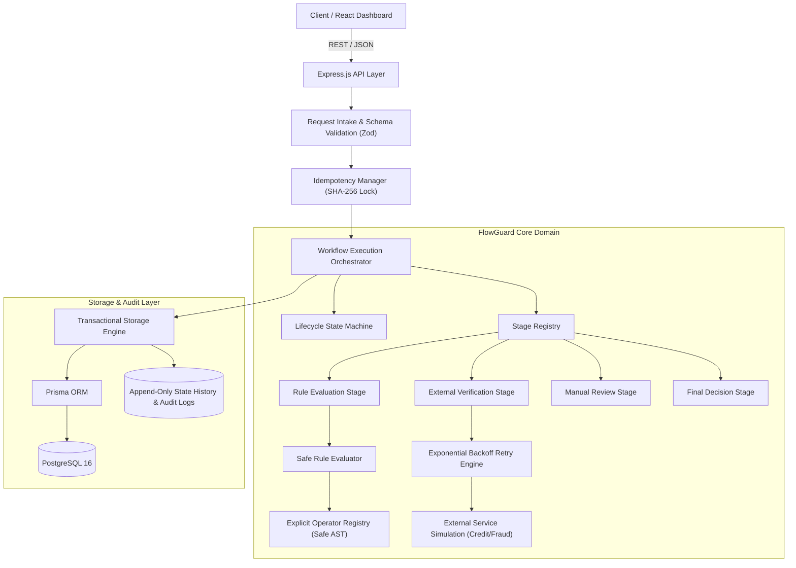
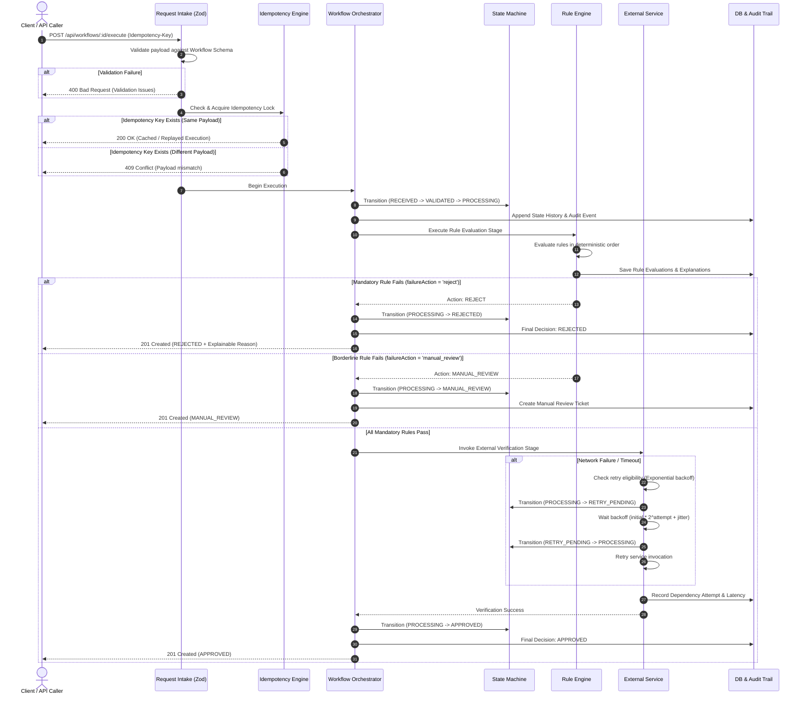
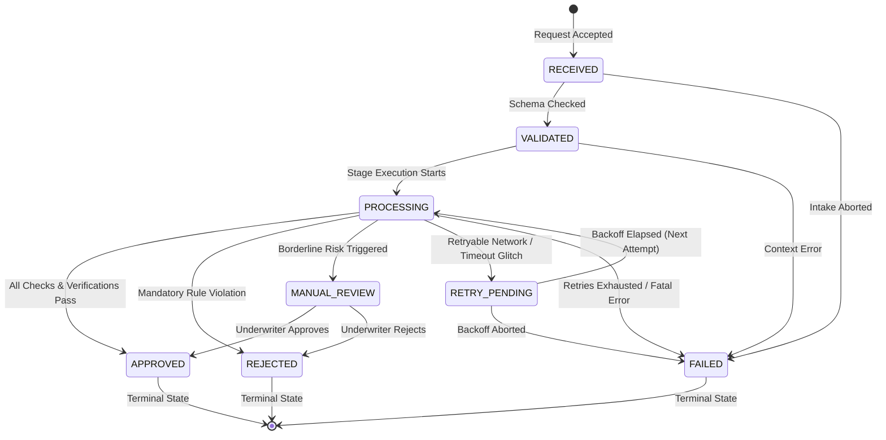
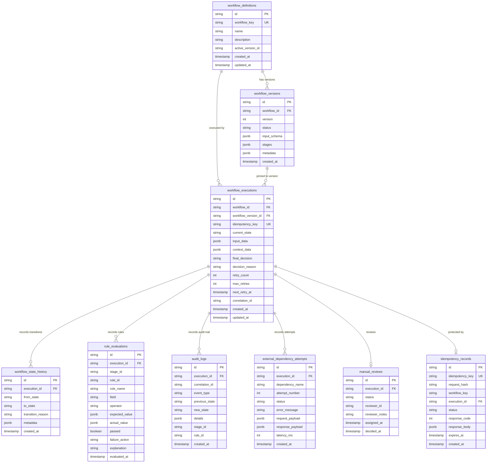

# FlowGuard Architecture Specification

FlowGuard is a workflow decision and state orchestration engine designed for business processes that require deterministic rule evaluation, idempotency guarantees, fault tolerance, and comprehensive auditability.

---

## High-Level Architecture



---

## Request Execution Sequence



---

## Workflow State Machine Lifecycle



---

## Resilience & Retry Flow

```mermaid
flowchart TD
    Invoke["Invoke External Dependency"] --> Attempt["Record Attempt in DB"]
    Attempt --> Call["Call External Service"]
    
    Call -->|Success| Merge["Merge Result into Workflow Context"]
    Merge --> NextStage["Advance to Next Pipeline Stage"]

    Call -->|Failure / Error| Classify["Classify Error Type"]
    Classify -->|Business Rejection| NoRetry["Do NOT Retry! Mark Rejected"]
    Classify -->|Permanent 400| NoRetryPerm["Do NOT Retry! Mark Failed"]

    Classify -->|Retryable 408/429/503/ETIMEDOUT| CheckCount{"Attempts < Max Retries?"}
    CheckCount -->|No (Exhausted)| Exhausted["Mark Execution FAILED (Max Attempts Reached)"]
    CheckCount -->|Yes| CalcDelay["Calculate Exponential Backoff: delay = initial * (multiplier^attempt) + jitter"]
    
    CalcDelay --> StateRetry["Transition State to RETRY_PENDING"]
    StateRetry --> Sleep["Wait Backoff Duration"]
    Sleep --> StateProc["Transition State to PROCESSING"]
    StateProc --> Call
```

---

## Database Entity Relationships (ERD)



---

## Architectural Justifications & Trade-offs

### Modular Monolith vs. Distributed Microservices
- **Choice**: Modular Monolith with strictly separated domain, application, and infrastructure layers.
- **Justification**: Eliminates distributed transaction failures, dual-write anomalies, and network hop latency during early lifecycle iterations. Boundaries are cleanly decoupled so `RuleEvaluationStage` or `ExternalVerificationStage` can be extracted into independent worker containers if horizontal scale warrants.

### PostgreSQL with Prisma ORM
- **Choice**: PostgreSQL 16 with Prisma ORM.
- **Justification**: ACID compliance is mandatory for financial decisions. PostgreSQL provides atomic transactions, unique constraints on idempotency keys, and indexed JSONB columns for flexible configuration schemas without sacrificing relational integrity.

### Safe Operator Registry vs. Dynamic JavaScript Evaluation
- **Choice**: Closed operator registry (`gt`, `gte`, `lt`, `lte`, `eq`, `neq`, `in`, `not_in`, `between`, `exists`).
- **Justification**: Executing code submitted in workflow configurations (`eval` or `Function`) is a severe security vulnerability (Remote Code Execution). The explicit operator registry guarantees mathematical determinism, total isolation, and 100% human-explainable traces.

### Idempotency vs. Duplicate Detection
- **Idempotency**: Guarantees that repeating the request with the identical `Idempotency-Key` and identical payload produces the exact same outcome without re-executing side effects or duplicating database records.
- **Conflict Protection**: Reusing the same key with a modified payload is identified as a dangerous ambiguity and rejected immediately with `409 Conflict`.

